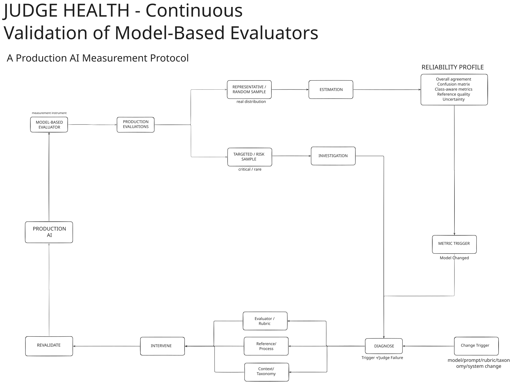

# Judge Health
**A Continuous Validation Protocol for Model-Based Evaluators**  
*A Production AI Measurement Protocol*

> Who evaluates the evaluator?

---

## Judge Health Protocol

Judge Health treats a model-based evaluator as a measurement instrument that must itself be continuously validated.

<p align="center">
  
</p>

The diagram shows the auditable loop: production evaluations from a configured model-based evaluator, reference labels and review, a representative sample for population-level reliability estimates, and separate targeted/risk cases excluded from those estimates. Reliability metrics feed metric and change triggers, then diagnosis and intervention. Each candidate is revalidated against the reference evidence. An Evidence Gate combines representative metrics, targeted/risk checks, and deployment-specific acceptance criteria. If the criteria are not met, the candidate is rejected and revised, then revalidated again. Meeting the criteria does not authorize promotion: explicit human approval is required first.

---

## The Problem

Model-based evaluators (LLM-as-judge) are increasingly used to automate quality assessment at scale. The core problem is **silent reliability degradation**:

- An evaluator scoring 90% overall agreement may have 100% recall on the easy majority class while **missing 50% of the high-stakes minority class**
- When the evaluator is updated, the new version inherits no prior reliability guarantee — it must be revalidated from scratch
- Without a formal protocol, evaluator changes are made by intuition, not evidence

Headline metrics hide the failure modes that matter most.

---

## Live Calibration Result — Run #0001

The first end-to-end live calibration cycle has been completed.

The reference labels in Run #0001 are synthetic, AI-generated demonstration data, not independently annotated human ground truth. Production use requires an appropriately validated human-reference process.

The figures below are the recorded outcome of that worked example. They are not an independently validated measure of effectiveness.

```
Calibration Run #0001 — Completed 2026-10-07

Baseline (v0.2.0)                  Promoted (v0.2.0-candidate.20261007-fn7p)
─────────────────────────────────  ──────────────────────────────────────────
Overall Agreement      13.3%       Overall Agreement       91.7%   (+78.3pp)
FAIL Recall           100%         FAIL Recall            100%    (preserved)
False Positives        52          False Positives          5      (−47)
Targeted FAIL detect   8/8         Targeted FAIL detect    8/8    (preserved)
Targeted PASS correct  0/2         Targeted PASS correct   2/2

12 candidates evaluated — 11 rejected — 1 promoted
```

**The candidate with the highest overall agreement (98.3%) was not promoted.**  
Candidate #8 reached 98.3% OA but missed one targeted-risk FAIL case. Candidate #12 reached 91.7% OA and detected all 8/8 targeted-risk FAIL cases. The protocol required both.

> Judge Health is not an accuracy optimizer. It is a reliability instrument for a defined evaluation objective that includes explicitly identified risk scenarios.

[Read the full calibration experiment → docs/case-study.md](./docs/case-study.md)

---

## The Protocol

Judge Health operationalises a continuous validation lifecycle for model-based evaluators:

```
Production evaluations (configured model-based evaluator)
        ↓
Reference labels and review
        ↓
Representative sample   →  population-level reliability estimates
Targeted/risk cases     →  investigation only (excluded from those estimates)
        ↓
Reliability metrics  →  metric trigger / change trigger
        ↓
Diagnosis  →  Intervention
        ↓
Candidate revalidation against reference evidence
        ↓
Evidence Gate
  representative metrics
  + targeted/risk checks
  + deployment-specific acceptance criteria
        ↓
   not met → reject and revise the candidate → revalidate again
   met     → explicit human approval required
        ↓
Promote the approved candidate
        ↓
Calibration record (immutable)
```

**Lifecycle invariant**: the active evaluator is never silently modified. A candidate stays isolated until it is revalidated and checked at the Evidence Gate. Meeting acceptance criteria does not authorize promotion; a person must approve it. A rejection sends that candidate back for revision and another revalidation. The loop is operated by people, not an autonomous self-healing process.

---

## Core Concepts

| Concept | Description |
|---|---|
| **Representative sample** | Reflects true population distribution — the only sample valid for population-level reliability estimates |
| **Targeted/risk sample** | Selected for investigation (known failures, high-stakes edge cases) — analytically isolated, never used for population estimates |
| **Positive class = FAIL** | Minority/high-stakes class; recall on FAIL is the primary metric |
| **Class-aware profile** | Confusion matrix + per-class recall with 95% Wilson score CIs |
| **Metric trigger** | A configured boundary was crossed — investigate, not conclude |
| **Change trigger** | Evaluator/rubric/taxonomy version changed — full revalidation required |
| **Diagnosis first** | Root cause must be categorised before any intervention |
| **Candidate isolation** | Intervention creates a new candidate; the active evaluator is never mutated |
| **Historical immutability** | Every attempt and decision is sealed; nothing is overwritten |

---

## Implemented Capabilities

The following capabilities are confirmed in the current codebase:

- **Live baseline run** — real OpenAI API calls, server-side only, evaluator never receives reference labels or prior judgments
- **Durable persistence** — atomic write-through JSON (`experiment-data/`), stores hydrate on server startup (crash/restart-safe)
- **Reliability profile** — confusion matrix, per-class recall, Wilson 95% CI, false positive / false negative rates
- **Metric triggers** — configured thresholds per deployment context; no universal defaults
- **Change triggers** — detected from version metadata; trigger investigation workflow
- **Diagnosis workflow** — five root-cause categories; required before intervention is enabled
- **Intervention + candidate** — proposed rubric change creates a versioned candidate; active rubric is never modified
- **Candidate revalidation** — live run against the same representative protocol from scratch
- **Human accept/reject** — explicit decision required; promotes or rejects the candidate
- **Calibration report** — sealed trajectory of all attempts with delta KPIs and rubric diff (LCS)
- **Service record / history** — chronological log of all events derived from persisted data
- **Evidence page with run selector** — any persisted run (baseline or candidate) inspectable by its exact sealed judgments; `?run=<runId>` URL param
- **Settings / reset** — destructive reset behind an explicit action; never automatic

---

## Running Locally

**Prerequisites**: Node.js 18+, an OpenAI API key.

```bash
git clone <repo-url>
cd judge-health
npm install
```

Create `.env` (see `.env.example`):

```bash
cp .env.example .env
# then add your real OPENAI_API_KEY
```

Start the dev server:

```bash
npm run dev        # http://localhost:3000
```

> The application starts in a clean state. Run the **Live Baseline** from the Overview page to establish the baseline reliability profile before the rest of the workflow is available.

---

## Tests

```bash
npm test
```

All tests run against deterministic fixtures and mocked OpenAI client. No API credits are spent during test runs.

Current test coverage spans: lifecycle integration, workflow store mutations, persistence round-trips, history builder, calibration report, evidence run selector logic.

---

## Documentation

| Document | Description |
|---|---|
| [`docs/methodology.md`](./docs/methodology.md) | Complete methodology — evaluator as measurement instrument, protocol components, failure modes |
| [`docs/architecture.md`](./docs/architecture.md) | Source-derived architecture, data flow, security invariants |
| [`docs/case-study.md`](./docs/case-study.md) | Calibration Run #0001 — completed live calibration experiment |
| [`docs/calibration-run-0001.md`](./docs/calibration-run-0001.md) | Immutable technical record of Run #0001 (all versions, metrics, decisions) |
| [`LIMITATIONS.md`](./LIMITATIONS.md) | Known limitations and design constraints |

---

## Project Status

**Experimental / Research Prototype**

This is a working research implementation of the Judge Health methodology. It is not a production-ready SaaS tool. It runs as a single-user local Next.js application. No authentication, no multi-tenancy, no hosted service.

The first end-to-end live calibration cycle has been completed. Calibration Run #0001 evaluated 12 candidate evaluator versions and resulted in one human-approved promotion. The full record is in [`docs/case-study.md`](./docs/case-study.md).

---

## AACI Framework

**AACI** is a broader continuous improvement and operational control framework for production AI agents. **Judge Health** is a focused measurement protocol for validating and recalibrating model-based evaluators. Judge Health is a component within the broader AACI approach, not a synonym for AACI.

[AACI project](https://github.com/PdroBrandao/aaci)

---

*Pedro Brandão — 2026*
