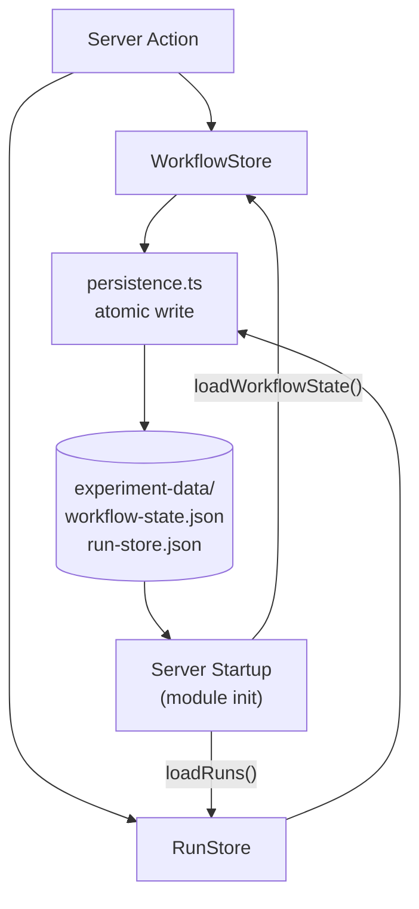

# Judge Health — Architecture

This document describes the actual architecture derived from the source tree. All module names and paths are current as of the latest commit.

---

## Stack

| Layer | Technology | Version |
|---|---|---|
| Framework | Next.js App Router | 16.3.7 |
| Language | TypeScript | 5.x |
| Styling | Tailwind CSS | 4.x |
| Validation | Zod | 4.x |
| Charts | Recharts | 3.x |
| Tests | Vitest | 2.x |
| LLM Client | OpenAI SDK | 7.x |
| Runtime | Node.js | 18+ |

---

## Layer Overview

```
Browser
  └── Next.js App Router (React Server Components + Client Components)
        └── Server Actions  (src/app/actions/)
              └── Domain Stores  (WorkflowStore, RunStore)
                    └── Persistence  (src/data/persistence.ts)
                          └── Disk  (experiment-data/)
              └── Live Evaluator  (src/core/evaluator/)
                    └── OpenAI API  [server-side only]
```

---

## Application Layer — Routes

All routes are React Server Components (RSC) unless marked `"use client"`.

| Route | Purpose |
|---|---|
| `/` (Overview) | Live reliability profile, metric/change triggers, workflow state summary |
| `/evidence` | All cases: representative + targeted/risk streams, run selector (`?run=<runId>`) |
| `/evidence/[id]` | Case detail: input, reference label, evaluator judgment, rationale (`?run=<runId>`) |
| `/diagnose` | Root-cause diagnosis form (required before intervention) |
| `/intervention` | Rubric editor — proposes a candidate evaluator version |
| `/revalidation` | Candidate revalidation runner + judgment-by-judgment comparison |
| `/history` | Service record — chronological log of all events derived from persisted data |
| `/calibration-report` | Sealed trajectory: delta KPIs, rubric diff (LCS), per-attempt accordion |
| `/settings` | Persistence file status, experiment summary, destructive Reset action |

### Server Actions (`src/app/actions/`)

| Action | Effect |
|---|---|
| `actionRunLiveBaseline()` | Creates + starts a baseline `EvaluationRun`; calls OpenAI server-side |
| `actionSubmitBlindReview()` | Records baseline decision (accept/proceed) |
| `actionSubmitDiagnosis()` | Records diagnosis category; enables intervention |
| `actionCreateIntervention()` | Creates an intervention record |
| `actionCreateCandidate()` | Creates a candidate with a proposed rubric |
| `actionRunLiveRevalidation()` | Creates + starts a candidate `EvaluationRun` |
| `actionRecordDecision()` | Seals accept/reject decision; updates candidate status |
| `actionStartNewAttempt()` | Clears current-attempt pointers; preserves all history |
| `actionResetExperiment()` | Destructive full reset (dev/research use only) |

All actions call `revalidatePath()` on affected routes and return via `redirect()` where appropriate.

---

## Core Domain (`src/core/`)

### Types (`src/core/types.ts`)

Central type definitions. Key interfaces:

- `WorkflowState` — the full experiment state (baseline, diagnosis, interventions, candidates, decisions)
- `CandidateRecord` — versioned candidate with `revalidationRunId`, `status`, `attemptNumber`
- `EvaluationRun` — sealed run: `sampleIds`, `judgments: LiveJudgment[]`, `status`, `mode` (fixture/live)
- `LiveJudgment` — single evaluator judgment: `caseId`, `label`, `rationale`, `model`, `timestamp`
- `EvidenceSummary` — per-case view model for the Evidence page
- `ReliabilityProfile` — computed metrics: OA, per-class recall, Wilson CIs, FP/FN rates

### Metrics Engine (`src/core/metrics/`)

- `wilson-ci.ts` — Wilson score confidence interval (preferred over Wald at extreme proportions)
- `confusion-matrix.ts` — TP/FP/TN/FN computation; positive class = FAIL
- `reliability-profile.ts` — assembles the full profile from confusion matrix + Wilson CIs
- `computeReliabilityProfile()` — main entry point; accepts `Case[]` + `Judgment[]` + evaluator version

### Sampling (`src/core/sampling/`)

Separates `representative` from `targeted_risk` cases. The separation is enforced throughout — targeted/risk cases are never mixed into population estimates.

### Triggers (`src/core/triggers/`)

- `metric-triggers.ts` — evaluates whether observed metrics cross configured thresholds
- `change-triggers.ts` — detects version changes requiring revalidation (evaluator, rubric, taxonomy)

### Evaluator Abstraction (`src/core/evaluator/`)

- `types.ts` — `Evaluator` interface; `EvaluatorInput` never includes `groundTruth`, `humanLabel`, or any reference signal
- `openai-evaluator.ts` — live LLM calls; `import "server-only"` enforced; API key from env var only
- `fixture-evaluator.ts` — deterministic evaluator for tests; never spends API credits

---

## Data Layer (`src/data/`)

### WorkflowStore (`src/data/workflow-store.ts`)

In-memory singleton. Holds the full `WorkflowState`:

- `interventions[]` — append-only
- `candidates[]` — append-only
- `decisions[]` — append-only
- Current-attempt pointers (cleared by `startNewAttempt()`, history preserved)
- `baselineRunId` — ID of the sealed baseline run

Every mutating method calls `saveWorkflowState()` immediately after updating in-memory state (write-through).

Hydrates from disk on module initialization:
```typescript
let _state = (loadWorkflowState() as WorkflowState | null) ?? { ...INITIAL_STATE };
```

### RunStore (`src/data/run-store.ts`)

Append-only list of `EvaluationRun[]`. Key operations:

- `createRun()` — allocates a new run with `pending` status
- `startRun()` — transitions to `running`, records `startedAt`
- `addJudgment()` / `addError()` — append during execution
- `completeRun()` / `failRun()` — seals the run; immutable after this point
- `getRun(id)` — ID-scoped lookup (never "latest by type")

Every mutating method calls `saveRuns()` immediately (write-through).

### Persistence (`src/data/persistence.ts`)

Central I/O module. `import "server-only"` enforced.

- **Atomic writes**: write to `<file>.tmp` then `renameSync` → no partial files
- **Test guard**: all standard I/O functions are no-ops when `NODE_ENV=test`
- **Explicit-path variants**: `saveWorkflowStateTo(state, path)` / `loadWorkflowStateFrom(path)` — always perform real I/O; used by persistence tests with temp directories

Persistence files:

```
experiment-data/
  workflow-state.json    # WorkflowState snapshot
  run-store.json         # EvaluationRun[] array
```

Both files are gitignored. The live experiment state lives only on the researcher's machine.

### FixtureRepository (`src/data/fixture-repository.ts`)

Read-only validated access to deterministic fixture data. Used by the metrics engine, Evidence page, and tests. Never mixed with live run data in live mode.

---

## Data Flow — Persistence



Write path: `Server Action → Store mutation → saveXxx() → atomicWrite() → disk`  
Read path: `Module init → loadXxx() → disk → in-memory state`

The stores are write-through: every mutation is persisted synchronously before the action returns. This makes the state crash/restart-safe — a server restart re-hydrates from the last committed file.

---

## Security Invariants

| Invariant | Enforcement |
|---|---|
| API key never exposed to browser | `import "server-only"` in `openai-evaluator.ts` and `persistence.ts`; Next.js enforces this at build time |
| API key never hard-coded | Read from `process.env.OPENAI_API_KEY` only |
| Evaluator never receives reference labels | `EvaluatorInput` type excludes `groundTruth`; fixture data excluded from evaluator call |
| Evaluator never receives prior judgments | Each evaluation call is independent; no conversation history passed |
| No automatic OpenAI call on page load | All live runs are triggered explicitly by server actions; no RSC initiates an API call |
| Tests never spend API credits | `OpenAIEvaluator` is mocked in all test files; `NODE_ENV=test` guard skips I/O |

---

## Component Architecture

Client components (`"use client"`) are used only for interactivity that requires browser state:

| Component | Purpose |
|---|---|
| `AttemptAccordion.tsx` | Expandable per-attempt rows in Calibration Report |
| `DiagnoseClient.tsx` | Diagnosis form with radio group |
| `EvidenceRunSelector.tsx` | Run/version picker button strip (`useRouter`) |
| `LiveRunPanel.tsx` | Real-time run progress (polling or SSE) |
| `RevalidationClient.tsx` | Revalidation controls and judgment comparison |
| `SmokeTestPanel.tsx` | Fixture evaluator smoke test panel |

All other components are server-renderable. The default is RSC; `"use client"` is added only when necessary.

---

## Testing Strategy

| Test file | Coverage |
|---|---|
| `lifecycle.test.ts` | End-to-end workflow integration (44 tests) |
| `workflow.test.ts` | WorkflowStore mutations and state transitions (22 tests) |
| `persistence.test.ts` | Atomic write, round-trip, multi-file, temp-dir isolation (13 tests) |
| `history.test.ts` | `buildDynamicEntries()` with injectable deps (10 tests) |
| `calibration-report.test.ts` | Calibration report pure functions (9 tests) |
| `evidence-selector.test.ts` | `buildRunOptions()` + `resolveDefaultRunId()` (17 tests) |

All tests run with `NODE_ENV=test`. No OpenAI calls, no disk I/O to `experiment-data/`. Persistence tests use `fs.mkdtempSync()` temp directories with explicit-path variants.

---

*Judge Health Architecture — Pedro Brandão — 2026*
